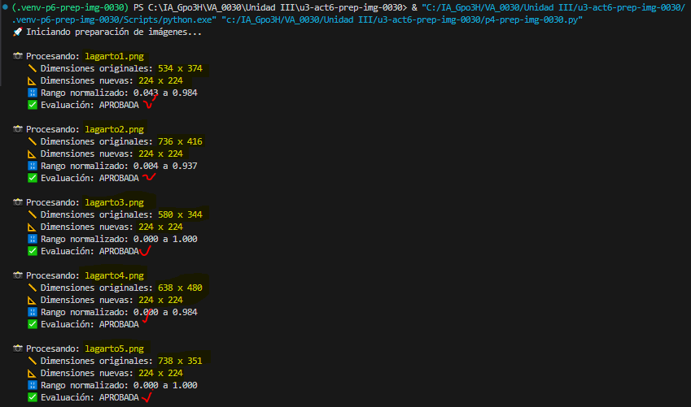
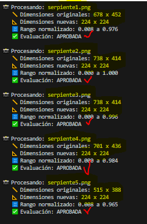
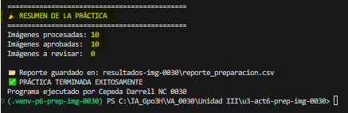

# 🚀 Práctica Guiada: Preparación y Evaluación de Imágenes para Visión Artificial

> **Nivel:** Básico – Principiante (Desde cero)  
> **Duración:** 2 horas  
> **Asignatura:** Soluciona problemas de Visión Artificial  
> **Especialidad:** Inteligencia Artificial  
> **Semestre:** 3º de Preparatoria  
> **Herramientas:** Python, Visual Studio Code, OpenCV y NumPy.

## Cepeda Darrell NC 0030   Fecha 24/11/2026
### *-*-*-* Primeras 5 imagenes de lagarto en codigo *-*-*-*

### *-*-*-* Primeras 5 imagenes de lagarto en codigo *-*-*-*

## *-*-*-* RESUMEN DE LA PRACTICA *-*-*-*
